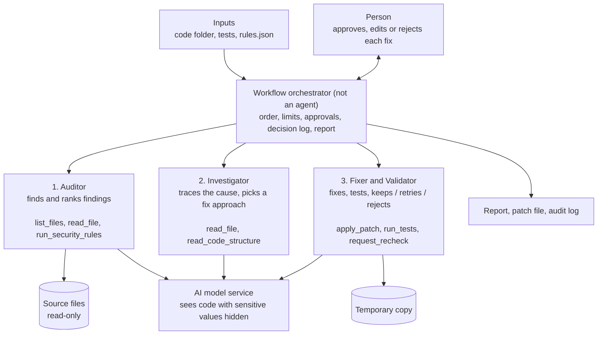

# Agent Opportunity Canvas: Security Analyzer Agent

*Security Analyzer Agent · IPL Neural Navigators · Cohort ICAIPM2026F*

**Team members:** Anshu, Archana, Bikash
**The Current Landscape: NorthBridge Technologies**
         **NorthBridge Technologies** is a mid-to-large B2B SaaS company providing financial and payments software to regulated enterprise clients across India and Southeast Asia. 
NorthBridge serves banks, fintechs, and insurers, and prides itself on frequent, reliable releases. With a growing engineering organization of ~400 developers across 
distributed teams, the company ships code continuously and operates under strict regulatory obligations — India's DPDP Act, RBI guidelines, SOC 2, and ISO 27001.

Today, NorthBridge's application-security process works like this:
1. **Scan:** Automated scanners run against each repository and generate long lists of potential vulnerabilities.
2. **Triage:** Engineers manually read the results, decide what is genuinely risky, and prioritize.
3. **Investigate & fix**: They reproduce findings, trace root causes, write fixes one at a time, and re-run tests.
4. **Prove & document:** They re-scan, gather before-and-after evidence, and prepare it for review and audit.

While scanners are good at flagging possible risks, the expensive work — prioritization, investigation, remediation, regression testing, and evidence collection — remains 
heavily manual and inconsistent.

**The Unsettling Reality: The "Backlog That Never Closes"**

*"Our scanners produce thousands of findings a quarter, but our engineers spend most of their security time just deciding what's real and what isn't," notes the Head of 
Application Security. "Serious issues get buried in noise, fixes get delayed before releases, and every audit we scramble to assemble the evidence by hand."*

A senior engineer adds: *"I lose hours reproducing a finding, tracing how bad input reaches it, writing a small fix, and then proving it didn't break anything. It's 
repetitive, and under release pressure, rushed fixes sometimes break working features."*

This reactive, manual approach leads to:
* Growing security debt — high-severity issues sitting unresolved in long lists.
*  Release bottlenecks — security remediation delaying ship dates.
*  Audit strain — no consistent before-and-after evidence trail.
*  Engineer burnout — senior talent stuck on repetitive remediation instead of high-value work.

These inefficiencies are estimated to cost NorthBridge a directional $0.75M–$1.5M annually in engineering time and delayed releases (to confirm during the pilot), on top 
of the unquantified risk of a vulnerability reaching production.

**The Spark of Innovation: Security Analyzer Agent**

Inspired by advances in Agentic AI, NorthBridge envisions the **Security Analyzer Agent** — a multi-agent, fix-and-prove system that checks source code against 
organization-owned security rules, investigates evidence-backed risks, prepares minimal tested fixes in an isolated copy, and leaves every real code change under human 
control. It does not replace engineers; it removes the repetitive triage-investigate-prove work so they can focus on judgment and release. This directly advances 
NorthBridge's strategic goals of **faster, safer releases, audit-readiness, and engineering efficiency — without adding headcount**.

**Scenario note:** NorthBridge Technologies, the organizational details, quoted statements, and the $0.75M–$1.5M annual cost estimate are illustrative assumptions. They will be validated or revised through discovery and pilot measurements.

## The canvas at a glance

| A · WHY | B · WHAT | C · HOW SAFE | D · HOW WE KNOW |
| --- | --- | --- | --- |
| **Posture:** it finds problems, prepares tested fixes and shows they work, but a person always decides what is applied | **Trigger:** a person starts it on a code folder, for example before a release or after an audit finding | **Human review:** a person approves every fix, and is also called in whenever the agent cannot decide | **Quality bar:** precision ≥ 85%, high-severity recall ≥ 90%, verified-fix success ≥ 75%, false-fix rate ≤ 5%, 100% evidence coverage, zero unsafe actions |
| **Problem:** security findings pile up because sorting them, fixing them and proving the fix are all manual work | **Tools:** 7 agent tools (read files, run security rules, read code structure, apply a fix, run tests, request a re-check) | **Main risks:** a wrong fix, code or secrets leaving the company, instructions hidden in code, running untrusted code | **Cost:** to be measured |
| **Outcome:** at least 30% less human time per scan, and a report of what was found and fixed as proof | **Steps:** scan, investigate, fix, verify, then a person approves | **Safeguards:** sensitive data is hidden before anything goes to the AI model, every fix is tested, every decision is logged | **Pilot:** one non-production repository, one language, three vulnerability classes, 3–5 engineers |
| **Agents:** Auditor, Investigator, Fixer & Validator, plus a workflow orchestrator that is not an agent | **Design:** three agents with separate jobs, coordinated by the workflow orchestrator | **Never allowed:** changing original files, committing or deploying code, sending secrets to the model | **Stop rule:** stop at once if the agent ever touches an original file or writes outside its temporary copy |

---

## A · WHY: the opportunity

### 1. Agent name, owner and posture

| Item | Answer |
| --- | --- |
| **Agent name** | Security Analyzer Agent |
| **Business owner** | Business owner responsible for engineering/application-security outcomes |
| **Product owner** | The product manager. Owns the specification, the default rules and the quality thresholds, and decides whether to roll back |
| **Posture, in one line** | A fix-and-prove agent, not an auto-merge agent. It identifies policy-defined code risks, investigates their causes, prepares minimal fixes in an isolated copy, verifies them, and presents the evidence to a human reviewer. |

### 2. Target persona, users and unmet needs

> **Evidence status:** Meera is an illustrative persona developed for the NorthBridge scenario. Her workflow, needs, and quotes are hypotheses to validate through interviews and pilot observations—not findings from completed user research.

#### Users and context

| Item | Answer |
| --- | --- |
| **Primary user** | Software engineer responsible for resolving application-security findings within a development team |
| **Secondary users** | Application-security engineers, code reviewers, engineering managers, release managers, and audit or compliance teams |
| **Context signals** | A release or merge is approaching; a security scan has generated findings; an audit issue or security ticket has been raised |
| **Trust hypothesis** | Engineers need original code to remain unchanged, sensitive information to be protected, findings to include evidence, and proposed fixes to remain reviewable and human-controlled |

#### Primary persona: Meera

Meera is a software engineer in one of NorthBridge Technologies’ distributed product-engineering teams. Alongside feature development, she is responsible for resolving application-security findings before code is merged or released.

She works with application-security engineers to interpret findings, code reviewers to approve changes, and release managers to understand delivery implications.

For Meera, success means resolving genuine security risks without breaking expected behavior, delaying releases unnecessarily, or leaving reviewers without sufficient evidence.

#### Current workflow

Meera’s security-remediation work typically begins when a scanner generates findings, an audit raises an issue, or a release approaches with unresolved security tickets.

Today, she manually:

1. Reviews scanner results and separates likely vulnerabilities from false positives.
2. Reads surrounding code and follows data across files to understand the root cause.
3. Writes a patch in a development branch, balancing security requirements with existing behavior.
4. Runs available tests and repeats the security scan.
5. Collects code references, patch details, and test results for security and code reviewers.

These activities are spread across tools and tickets. There is no consistent, connected evidence trail from the original finding to the proposed fix and its verification.

#### Goals and success criteria

Meera wants to:

- Identify the most important, evidence-backed risks quickly.
- Understand why an issue occurs before attempting a fix.
- Make the smallest appropriate change while preserving expected behavior.
- Distinguish a verified proposal from one that still needs investigation.
- Give reviewers a clear explanation and reproducible evidence.
- Retain control over every change applied to the real codebase.

#### Challenges and urgency

| Challenge | Impact on Meera |
| --- | --- |
| **Long, noisy finding lists** | Time is spent determining what is real instead of resolving the most important issues |
| **Fragmented investigation** | She reconstructs context across files, scan reports, and tickets before acting confidently |
| **Incomplete or unreliable tests** | Passing tests may not establish that a vulnerability is removed or expected behavior is preserved |
| **Manual evidence preparation** | She repeatedly explains the same investigation to security engineers and code reviewers |
| **Competing release commitments** | Remediation competes with feature delivery, creating pressure to accept fixes before they are fully understood |

The urgency increases near a release: unresolved findings need a defensible decision, but rushed remediation can introduce regressions.

**Meera needs faster investigation and verification—not simply another list of possible vulnerabilities.**

#### Jobs-to-be-done

**Core job statement**

> When a security finding needs resolution before release, I need to establish whether it represents a genuine risk, understand its cause, and prepare a minimal, evidence-backed fix, so that I can deliver secure code without introducing regressions and help reviewers make a confident decision.

**Supporting jobs**

- **Prioritize:** Separate genuine, high-impact risks from noise.
- **Investigate:** Trace the relevant source-to-sink path and explain the root cause.
- **Remediate:** Prepare a focused patch in an isolated workspace.
- **Verify:** Check that the issue is resolved and expected behavior remains intact.
- **Communicate:** Present the finding, patch, checks, and remaining uncertainty together.
- **Escalate:** Recognize when missing context, weak tests, or architectural complexity requires additional human judgment.

#### Unmet needs

| Need type | What Meera needs | Why the current workflow falls short |
| --- | --- | --- |
| **Functional: prioritization** | Evidence-backed findings with clear severity and contextual reasoning | Scanner output still requires substantial manual interpretation |
| **Functional: investigation** | A traceable explanation of how unsafe input reaches a vulnerable operation | Rule matches alone do not establish the complete root cause |
| **Functional: safe remediation** | Minimal, reviewable patches prepared without changing original files | Investigation, patch preparation, and safe execution are not consistently connected |
| **Functional: verification** | Before-and-after checks, regression results, and explicit uncertainty | A passing test or clean scan alone may create false confidence |
| **Functional: review readiness** | One evidence package linking the finding, explanation, patch, and validation | Evidence is assembled manually across tools and tickets |
| **Emotional** | Confidence, clarity about limitations, and control over changes | Weak evidence and release pressure create uncertainty about whether a fix is genuinely safe |
| **Social** | A defensible explanation that security engineers and reviewers can independently assess | Fragmented evidence leads to repeated explanations and avoidable review friction |

#### Illustrative voice of the user

*These statements express persona hypotheses; they are not verified interview quotations.*

> “We get these scanner reports every week, and half the time I’m not sure which ones are real.”

> “By the time I finish one issue, I have to explain it again to security and to my reviewer.”

> “I don’t want a patch that looks clever. I want a small fix I can defend, rerun, and prove is safe.”

#### Adoption and trust requirements

Meera is likely to consider the Security Analyzer Agent useful only if:

- Original source files remain unchanged.
- Confidential code is processed only in approved environments, with secrets and personal data protected.
- Findings include inspectable code evidence and clear explanations.
- Proposed patches are small, reviewable, and accompanied by validation results.
- Uncertain cases are labelled **unverified** and escalated rather than presented as fixed.
- She can approve, edit, or reject a proposal before applying changes through the team’s normal development process.

#### Persona validation plan

During discovery and the pilot, validate these hypotheses with **3–5 engineers and an application-security reviewer**.

| Hypothesis to validate | Evidence to collect |
| --- | --- |
| Triage and investigation consume substantial remediation effort | Observe recent cases and record time spent at each workflow stage |
| Evidence preparation causes repeated work | Review tickets and review comments for repeated explanations or missing artifacts |
| Test quality limits trust in proposed fixes | Examine available tests and ask participants what additional checks they require |
| Isolation and human approval are essential to adoption | Observe acceptance, edits, and rejection; record the reasons |
| The agent reduces effort without weakening review quality | Compare equivalent manual and agent-assisted tasks, including review time, alongside expert assessment of the resulting fixes |


### 3. The problem, reframed

| Item | Answer |
| --- | --- |
| **Surface framing** | Teams say "we need a better scanner" or "developers need more security training" |
| **Actual problem** | Existing scanners identify possible risks but leave the expensive work of prioritization, investigation, remediation, regression testing, and evidence collection to engineers. |
| **Today's process** | An engineer runs a scanner or waits for an audit, reads the results, decides what to fix first, fixes items one at a time, then reruns the tests and the scan |
| **What breaks today** | Serious problems get buried in long lists, fixes are delayed, rushed fixes can break working features, and there is no before-and-after evidence |

### 4. Job to be done

**As a** senior engineer who is responsible for security in my team, **I need to** know what is genuinely risky in my code and get safe, tested fixes, **so that** I can release without leaving security problems behind and can show progress.

**The agent's job, in one sentence:** *"Given a source-code folder, its automated tests and an approved security-rules file, the Security Analyzer agent finds and ranks the places that break the rules, investigates their causes and prepares tested fixes in a safe copy, without modifying the original files and without applying an unapproved change."*

### 5. Agentic value proposition, business strategy alignment and outcomes

#### Value proposition

**For software engineers and application-security teams managing a growing security backlog, the Security Analyzer Agent turns potential vulnerabilities into evidence-backed findings and review-ready fix proposals.**

It coordinates investigation, minimal patch preparation, regression testing, and security rechecks in an isolated workspace. Engineers spend less time on repetitive remediation and documentation while retaining control over changes to the real codebase.

**Our value proposition: less manual security work, better-supported review decisions, and a consistent evidence trail—with human control over every accepted change.**

> **Validation status:** The benefits, financial assumptions, and quality thresholds below are proposed for the pilot. They are not demonstrated results.

#### Why agentic AI creates value

The opportunity is not simply to find more vulnerabilities. It is to connect the manual work that happens after a finding appears.

**Find → Investigate → Prepare a fix → Verify → Human review**

| Component | What it contributes | Expected value |
| --- | --- | --- |
| **Auditor** | Assesses and prioritizes findings using approved rules and code evidence | Less time sorting noisy results |
| **Investigator** | Traces the root cause and determines whether a scoped fix is appropriate | Less repetitive investigation and fewer unsupported fix attempts |
| **Fixer & Validator** | Prepares a minimal patch in an isolated copy, runs tests, and requests a separate Auditor recheck | Less manual patch preparation and more consistent verification |
| **Workflow orchestrator** | Controls handoffs, limits, approvals, and evidence assembly | A consistent, reviewable workflow with enforced safety boundaries |

Agentic reasoning is useful because the next action depends on code context, evidence, fixability, and validation results. The system must choose whether to investigate further, prepare a patch, retry, or escalate.

Deterministic tools perform operations such as rule execution, patch application, and test execution. Agents interpret the results and choose among bounded next steps.

#### Business strategy alignment

| Business priority | How the agent supports it | Proposed measure |
| --- | --- | --- |
| **Engineering efficiency** | Reduces repetitive triage, investigation, patch preparation, and evidence assembly | At least **30% less human effort** per completed scan-to-review workflow |
| **Faster, safer releases** | Helps engineers prepare reviewable security fixes sooner without removing human approval | Measure remediation turnaround and security-related release delays; establish the baseline during the pilot |
| **Security risk management** | Supports detection and remediation within approved vulnerability classes | **High-severity recall ≥90%**, **finding precision ≥85%**, and **false-fix rate ≤5%** on the benchmark |
| **Audit readiness** | Produces traceable findings, verification results, and decision records | **100% required evidence coverage** and **100% audit-record completeness** |
| **Capacity and cost control** | Releases engineering time for feature delivery and higher-value security work | Measure hours released, operating cost, and net capacity value |

Passing tests and security rechecks does not guarantee vulnerability-free code. Generated records can support secure-development assurance but do not independently establish regulatory compliance.

#### Directional business case

The following example estimates the value of engineering time released. All assumptions require validation.

| Assumption | Illustrative value |
| --- | ---: |
| Annual findings in the addressable workflow | 5,000 |
| Average manual effort per finding, including review and documentation | 2.5 hours |
| Loaded engineering cost | $60/hour |
| Target reduction in human effort | 30% |

**Current annual engineering effort**

    5,000 findings × 2.5 hours = 12,500 hours/year

**Current annual engineering-effort value**

    12,500 hours × $60/hour = $750,000/year

**Potential annual capacity released**

    12,500 hours × 30% = 3,750 hours/year

**Potential gross annual capacity value**

    3,750 hours × $60/hour = $225,000/year

**Interpretation:** If the assumptions hold, achieving the target could release approximately **3,750 engineering hours annually**, valued at **$225,000 before agent operating costs**.

This is potential engineering-capacity value—not guaranteed cash savings or a commitment to reduce headcount.

**Net annual capacity value**

    Gross annual capacity value
    − Model inference costs
    − Execution and infrastructure costs
    − Rule and platform maintenance costs
    − Incremental oversight costs not already included in measured human effort

Human review remains part of the workflow. Its effort must be included in the manual-versus-agent-assisted comparison and must not be deducted twice.

One-time implementation costs will be assessed separately. Release-delay benefits and avoided incident costs are excluded from this example to avoid unsupported valuation.

If only part of the annual workload is eligible for the MVP, the estimate must be reduced to reflect that addressable volume.

#### Differentiation

**Our proposed differentiator is a controlled, organization-rule-driven “find, investigate, fix, and prove” workflow.**

It combines:

- Organization-owned security rules and severity definitions.
- Contextual investigation rather than isolated rule matches.
- Minimal patches prepared in an isolated workspace.
- Regression testing and a separate Auditor recheck.
- A consolidated evidence package for reviewers.
- Human acceptance of every proposed change.

Existing scanners and AI development tools may provide some of these capabilities. The pilot will assess whether this integrated workflow improves outcomes compared with NorthBridge’s current tools and process.

#### Outcomes and measurement

| Metric | Baseline today | Proposed target | How we measure it |
| --- | --- | --- | --- |
| **Human effort per completed scan-to-review workflow** | Measure during pilot | At least 30% lower than the manual workflow | Compare equivalent tasks, including triage, investigation, remediation, testing, documentation, and review |
| **Finding precision** | Measure on labelled benchmark | ≥85% | Expert-confirmed findings ÷ all reported findings |
| **High-severity finding recall** | Measure on labelled benchmark | ≥90% | Correctly detected high-severity cases ÷ all labelled high-severity cases |
| **Verified-fix success rate** | Measure on benchmark | ≥75% | Eligible attempted fixes confirmed to remove the issue and preserve expected behavior ÷ all eligible attempted fixes |
| **False-fix rate** | Measure on benchmark | ≤5% | Proposals labelled verified that expert review finds incorrect ÷ all proposals labelled verified |
| **Evidence coverage** | Measure current completeness | 100% | Reported findings containing all required evidence fields ÷ all reported findings |
| **Human approval rate** | Establish during pilot | ≥70% | Verified proposals approved by reviewers ÷ verified proposals reviewed |
| **Audit-record completeness** | Measure current completeness | 100% | Required audit records captured ÷ required audit records expected |
| **Unsafe actions** | Measure during testing and pilot | 0 | Monitor original-file integrity, workspace boundaries, network access, and prohibited actions |

Report the number of evaluated cases alongside every percentage. Small pilot samples provide directional evidence, not proof of reliable performance at scale.

#### Pilot business decision

Proceed beyond the pilot only if:

- Safety boundaries remain intact.
- Quality thresholds are supported by a sufficiently representative benchmark.
- Human effort is reduced without weakening review quality.
- Reviewers accept at least 70% of verified proposals.
- Measured benefits justify operating and maintenance costs.
- Code-processing and model-provider arrangements receive required approval.

#### Long-term risk of maintaining the current workflow

- **Growing security debt:** Finding backlogs may increase as repositories and release frequency grow.
- **Rising manual effort:** Investigation and evidence preparation continue to consume engineering capacity.
- **Release friction:** Unresolved security findings can delay release decisions.
- **Audit burden:** Fragmented evidence requires repeated reconstruction.
- **Engineer fatigue:** Repetitive remediation competes with higher-value engineering work.

These are risks to assess during discovery, not quantified benefits already achieved by the agent.

#### Explicit non-goals

The MVP will not:

- Modify original source files.
- Commit, push, merge, deploy, or open pull requests.
- Install or remove packages.
- Delete source files.
- Apply patches to the real codebase; engineers retain that responsibility.
- Perform large architectural redesigns.
- Replace penetration testing, threat modelling, code review, or the organization’s security program.
- Evaluate or rank developers.
- Generate or change security rules without security-owner approval.

### 6. Why agentic? (and why not)

| Agentic Need | ☑ / ✗ (Required?) | Why (Evidence) |
| --- | --- | --- |
| Multi-step reasoning | ☑ | The next action depends on finding confidence, root cause, fixability, tests, and re-scan results. |
| Tool use | ☑ | It must read code, invoke rules, inspect code structure, apply patches, run tests, and re-scan. |
| Persistent context across sessions | ✗ for MVP | Run-level context is sufficient; organizational learning comes through rules and benchmark updates. |
| Variable inputs | ☑ | Repositories differ in structure, coding patterns, dependencies, and data flows |
| Sufficient Volume | ☑ to validate | Security review repeats across releases and repositories |
| Bounded autonomy | ☑ | It can analyze and patch only inside an isolated temporary workspace |
| Independent verification | ☑ | The component writing a fix should not be the sole judge of its success |

**Why not a simpler scanner solution?**
A scanner can identify rule matches, but it does not necessarily:
- establish whether a finding is meaningful in its code context;
- trace how unsafe input reaches a sensitive operation;
- select a context-appropriate remediation;
- prepare and undo a patch;
- run regression tests;
- independently re-check whether the issue is resolved;
- assemble an approval-ready evidence package.

**Where a person must always decide:**
- whether a proposed fix is accepted;
- whether a fix is applied to the real codebase;
- whether a large redesign is undertaken;
- whether dependencies are added or removed;
- whether rules or severity levels are changed;
- what happens when tests are absent or unreliable;
- what happens when the root cause cannot be confidently determined.

---

## B · WHAT: the agent

### 7. Triggers and channels

| Item | Proposed entry |
| --- | --- |
| **Triggers** | Manual scan before release or merge; response to a security ticket; response to an audit finding |
| **Primary Channels** | Internal chat-style or web interface |
| **Secondary output channels** | Downloadable patch file, machine-readable results, security report, and audit log |
| **Channel constraints** | One project per run; one supported programming language in the MVP; human reviewer must be available; English-only interface initially |

### 8. Inputs, knowledge and data

| Source | What the agent uses it for | Owner | How fresh | Sensitivity |
| --- | --- | --- | --- | --- |
| Source-code folder | Scan and contextual investigation | Engineering team | Read at the start of each run | Confidential; may contain secrets or test PII |
| The rules file (`rules.json`) | Checks, severity, fix eligibility, and remediation guidance | application-security function or designated security owner | Version-controlled and checked at the start of each run | Internal |
| Existing automated tests | Regression verification | Engineering team | Current repository version and Run during each run | Internal |
| Test execution command | Determines how validation runs | Engineering team | Per repository | Internal |
| Policy settings |File, step, token, time, and retry limits | Product owner | Version-controlled | Internal |
| Model endpoint configuration | Controls approved inference environment | designated platform or security owner | Deployment configuration | Sensitive configuration |
| Benchmark dataset | Regression evaluation | Product and security owners | Updated after reviewed failures | Confidential |

**Consent and data minimisation.** Processing is permitted only for source code the organization is authorized to analyze. Applicable privacy, confidentiality, contractual, data-classification, and approved AI-provider requirements must be satisfied before processing.

**What the agent often cannot know.** It cannot tell how the code is deployed, whether a problem can really be reached in production, or whether the tests cover the behaviour it changed. When it is unsure, it says "unverified" instead of "fixed", shows the evidence it has, and hands the case to a person.

### 9. Tools and actions

A **tool** is something an agent chooses to use while it works. The workflow orchestrator's own steps are listed separately, because the agents do not choose them and cannot skip them.

**Agent tools (7)**

| Tool | Used by | What it does | Reads or changes? | Who approves its use | If it fails |
| --- | --- | --- | --- | --- | --- |
| `list_files` | Auditor | Lists the project's files, skipping folders such as version control and installed packages, up to the file cap | Reads only | The user, by choosing the folder | Stops and explains why |
| `read_file` | Auditor, Investigator | Reads one source file | Reads only | The user, by choosing the folder | Skips the file and notes it |
| `run_security_rules` | Auditor | Runs the text-pattern security rules from the rules file on the files | Reads only | The security engineer, by writing the rule | Skips a faulty rule and notes it |
| `read_code_structure` | Investigator | Reads how the code is built (functions and what calls what) to trace how bad input reaches a weak spot | Reads only | Built in | Hands the case to a person |
| `apply_patch` | Fixer & Validator | Applies a fix to the temporary copy, checks that the changed files are still valid code, and undoes the change if they are not | Changes the temporary copy only | The rule's fix setting, then a person | Undoes the change |
| `run_tests` | Fixer & Validator | Runs the project's own tests in the temporary copy | Runs the tests; changes nothing | The project team, which owns the tests and the test command | The fix is not called verified, and a person is told |
| `request_recheck` | Fixer & Validator | Asks the Auditor to run the rules again on the changed files and return the result | Reads only (the Auditor uses its own tools) | Built in | The fix is not called verified |

**Workflow steps (run by the workflow orchestrator, not chosen by any agent)**

| Step | When | What it does | If it fails |
| --- | --- | --- | --- |
| Validate the rules file | At the start | Checks that `rules.json` is valid and loads the rules | Stops with a clear message |
| Create the temporary copy | Before any fix | Makes the temporary copy of the project that fixes are tried in | Stops the run |
| Ask a person to approve | After each fix passes its checks | Shows the fix with its evidence in the agent interface and waits for the person to approve, edit or reject | The fix stays unapplied |
| Enforce the limits | Throughout | Caps on files, AI calls, time and retries; hands the case to a person when a cap is reached | Stops the run |
| Check the originals are unchanged | At the end | Confirms that the original files were not changed | Stops the run and raises an alert |
| Write the decision log | Throughout | Records every decision made by the agents and the workflow orchestrator | Stops the run, because decisions must always be logged |
| Write the report | At the end | Builds the report (with the totals) and the patch file from the results the agents recorded | Writes a partial report |

**The agent may do these on its own:** read files, run the rules, investigate, rank the findings, prepare and test fixes in the temporary copy, undo a failed fix, retry once, and write the report.

**The agent must never:** change the original files; commit, push, merge or deploy; apply a fix without approval; send code anywhere except the AI model service; send secrets unhidden; edit the rules file; add or remove software packages; or delete files.

### 10. Decision loop and architecture

**Perceive → Decide → Act → Learn**

- **Perceive:** reads the rules, the code, the scan findings, and the test and re-check results.
- **Decide:** the Auditor decides which findings have enough evidence. The Investigator decides how a problem arises and which fix suits it. The Fixer & Validator decides whether to keep, retry or reject a fix, based on the tests and the Auditor's re-check.
- **Act:** writes the smallest fix that works in the temporary copy, runs the tests, asks the Auditor to re-check, asks a person to approve, and writes the report.
- **Learn:** every decision is logged. Rejected or undone fixes are added to the benchmark, and the rules and prompts are improved over time. The AI model is not retrained.

**For each finding, the agents decide in this order:**

1. No proof (file, line and code)? Drop the finding.
2. Needs a big redesign, or the cause is unclear? Stop and ask a person.
3. The rule's fix setting is off? Report the problem but do not fix it.
4. Otherwise prepare a fix in the temporary copy and test it. If the tests pass and the re-check is clear, a person approves it. If not, the agent retries once; if it fails again, the fix is rejected and listed in the report with the evidence.

**Patterns used:** ☑ pipeline ☑ routing ☑ parallelisation ☑ reflection ☑ tool use ☐ MCP ☐ planning ☑ multi-agent

**Single or multi-agent?** Multi-agent: three agents plus a workflow orchestrator. Finding, explaining and fixing are different jobs with different cost and risk, and the agent that writes a fix does not decide alone whether it worked: the project's tests and the Auditor's re-check decide that.

| Agent | What it does | If it fails | Why an agent, not a tool |
| --- | --- | --- | --- |
| Auditor | Applies all the rules to the whole project and ranks the findings | Nothing is found, so the run stops | AI-based rules and ranking need judgement; only its text search is a plain tool |
| Investigator | Works out how bad input reaches one weak spot | Fixes would be guesses, so a person takes over | Following data across the code is reasoning, not a lookup |
| Fixer & Validator | Writes the fix, runs the tests, asks the Auditor to re-check, and decides to keep, retry or reject | Nothing is verified, so nothing is called fixed | Deciding from test results needs judgement; running the tests is a plain tool |

**Three-sentence test for each agent.** Sentence 1 says what the agent decides; sentence 2 says what it chooses between and from what evidence; sentence 3 says what breaks if it were a plain tool call. An agent that fails the test becomes a tool call.

| Agent | Sentence 1: what it decides | Sentence 2: what it chooses between, and from what | Sentence 3: what breaks as a plain tool call | Verdict |
| --- | --- | --- | --- | --- |
| **Auditor** | It decides which findings have enough evidence to be reported and in what priority order. | It chooses between keeping, dropping and ranking each candidate finding, using the rule match, the surrounding code and the AI-based rules. | A scan tool would still return text-pattern matches, but it could not judge AI-based rules or rank findings by context, so engineers would be back to a long unsorted list. | **Passes, narrowly.** Its text search (`run_security_rules`) is already a tool. It stays an agent only while AI-based rules and ranking are in scope. If the pilot used text-pattern rules only, collapse it into that tool plus a sort. |
| **Investigator** | It decides how untrusted input reaches one weak spot and which kind of fix suits that path. | It chooses between fix approaches and between "fixable" and "hand to a person", using the code structure and the files it reads. | A lookup cannot follow data across several files or decide when the cause is unclear, so fixes would be guesses. | **Passes.** |
| **Fixer & Validator** | It decides whether a fix is kept, retried once or rejected. | It chooses between those outcomes using the test results and the Auditor's re-check, not its own opinion of its patch. | Running tests is a plain tool, but reading mixed test and re-check results and deciding keep, retry or reject needs judgement. | **Passes.** |

**Limits on each run:** one retry per finding, and caps on files, AI calls and time (values to be identified).

**Architecture sketch:**



Every hand-off goes through the workflow orchestrator; the agents never call each other.

### 11. Outputs and the I/O contract

```
Input:  { source_folder, rules_file, policy { file_cap, max_retries, test_command } }
Output: { totals { found, fixed_and_verified, rejected, needs_a_person, remaining },
          findings[ { rule_id, file, line, severity, evidence, confidence, detected_by,
                      status, patch_diff, tests, recheck } ],
          approvals, audit_log }
```

**Required for trust and audit (not just engineering preferences):** `evidence` (file, line and quoted code), `confidence`, `detected_by` (a rule or the AI model), `status`, `recheck`, `approvals` and `audit_log`. The report also records the rules-file version, the AI model and its version, and how many sensitive items were hidden.

---

## C · HOW SAFE: Trust

### 12. Human-in-the-loop design

| Item | Proposed entry |
| --- | --- |
| **Pattern** | A person approves every fix before it leaves the temporary copy, and the agent also hands over any case it cannot decide |
| **Human triggers** | Every fix; unclear cause; large redesign; failed retry; absent or failing tests; resource limit reached; malformed model output; low-confidence AI-only finding |
| **Handoff package** | Rule, severity, confidence, file and line, code evidence, traced cause, patch diff, tests before and after, re-check result, and residual risk |
| **Human SLA** | Define during pilot; until reviewed, the proposal remains unapplied |
| **Feedback** | Approval, edit, rejection, and reason are logged; reviewed failures become benchmark cases. |

### 13. Risks, failure modes and guardrails

**Spec line:** **Zero** writes to original files or outside the temporary copy, and **zero** unmasked secrets sent to the model, in every run; the number is zero because a single occurrence breaks the trust condition engineers set for using the tool at all, and a miss means a security incident, an immediate stop of the pilot and lost reviewer trust.

| Risk or failure mode | Likelihood | Impact | What protects us (Guardrail) |
| --- | --- | --- | --- |
| A false fix: the agent says it fixed the problem, but it did not, or the fix is wrong | M | H | Verified only if the tests pass and the re-check is clear. A person approves every fix, and we track the false-fix rate |
| Patch creates an undetected regression | M | H | Smallest possible change, tests green before we start, a person reviews every change, nothing applied automatically |
| Secrets or personal data reach the AI vendor | M | H | Data masking, local processing where possible, approved private endpoint |
| Instructions hidden in code comments try to steer the AI model | M | M | Treat code as untrusted data; structured model output; no direct model tool access |
| The tests or the changes run something harmful | L | H | Isolated container, restricted filesystem, no credentials, network deny-by-default |
| The AI model reports problems that are not real | H | M | A finding must show its file, line and code, or it is dropped |
| The rules file is wrong or has been tampered with | L | H |Version control, integrity validation, version recorded in every report |
| The AI model changes behaviour after a vendor update | M | M | The model version is fixed, and the benchmark is re-run on every change |
| Agent changes original files | L | H | Read-only mount, file-integrity check, immediate stop and alert |

**Input safeguards:** reads only the given folder, caps the number of files, checks the rules file, hides secrets and personal data before anything goes to the AI model, and treats code as data, never as instructions.

**Output safeguards:** model replies must follow a strict format; every finding shows its file, line and code; changed files must still be valid code; a fix is "verified" only when the tests pass and the re-check is clean; the original files are checked to be unchanged.

**Regulation and policy** (legal review needed):

- **India's DPDP Act, 2023:** applies if the code or test data holds personal data. Send as little as possible to the AI vendor, hide personal data, and have data-processing terms with the vendor.
- **Sector rules (for example RBI) and customer contracts:** regulated or confidential code may not be allowed to go to an outside AI vendor. Get compliance sign-off, or use a private model endpoint.
- **SOC 2 and ISO 27001** (security standards companies are audited against): not required of the product, but the report and decision log can serve as evidence of secure development.
- Internal secure-development and data-classification policies.

**Accountability:** the engineer who approves a fix owns that change. The product owner owns the agent's behaviour, its false-fix rate and the rollback decision. The business owner owns the outcomes.

---

## D · HOW WE KNOW: proof and cost

### 14. Evaluation and quality bar

Two criteria are non-negotiable: 100% evidence coverage and zero unsafe workspace actions. The other thresholds are proposed for the pilot.

**Spec line:** **False-fix rate ≤ 5%** of fixes labelled verified, because every fix is human-reviewed and above roughly 1 wrong "verified" label in 20 reviewers stop trusting the label; a miss means a reviewer approves a fix that leaves the hole open, the team believes it is closed, and the risk ships unnoticed. *(Proposed rationale, to confirm on the pilot benchmark. With about 20 verified fixes, one error already equals 5%, so treat the figure as directional until the set is larger.)*

**Proposed pilot quality gates**

| Quality criterion | Proposed Threshold | Rationale (Why it matters) |
| --- | --- | --- |
| **Findings with file, line, and code evidence** | 100% | Unsupported findings cannot be reviewed |
| **Original-file or out-of-workspace writes** | 0 | Any occurrence violates the safety boundary |
| **High-severity detection recall** | ≥ 90% | Missing a serious vulnerability is costly |
| **Finding precision** | ≥ 85% | Excessive false positives destroy adoption |
| **Verified-fix success rate** | ≥ 75% | False confidence is worse than an unresolved finding |
| **False-fix rate** | ≤ 5% | Failing patches cannot be labelled verified |
| **Regression-test pass rate for verified fixes** | 100% | A fix that fails the tests cannot be labelled verified |
| **Human approval rate of verified proposals** | ≥ 70% | Low acceptance suggests poor usefulness or trust |
| **Audit-record completeness** | 100% | Required for governance and evaluation |

**Golden dataset**
Start with the minimum: **11 deliberately vulnerable examples, one per type below**, and grow the set as failed or rejected fixes are reviewed. With one example per type the thresholds cannot be measured yet, so early results are directional. Types to include:
- SQL injection.
- Command injection.
- Path traversal.
- Safe code that resembles vulnerable code.
- Multi-file source-to-sink paths.
- Cases requiring dependency changes.
- Cases requiring architectural redesign.
- Missing and failing tests.
- Prompt-injection-like comments.
- Secrets and personal data in test fixtures.
- Cases in which the correct decision is to stop and escalate.

**Evaluation methods**
Use deterministic evaluation for:
- vulnerability presence;
- test outcomes;
- source-file integrity;
- workspace boundaries;
- syntax validity;
- patch size;
- evidence completeness.

Use expert review for:
- whether the vulnerability is genuine;
- whether the root-cause explanation is correct;
- whether the patch is minimal and maintainable;
- whether residual risk is represented correctly.

**Evaluation cadence**
- Full benchmark for every prompt, rule, or model change.
- Full regression evaluation before release.
- Sample approved and rejected fixes during the pilot.
- Immediate alert for any unsafe action.
- Track precision, recall, false-fix rate, retry rate, approval rate, time, and cost per run.

### 15. Cost and feasibility

| Item | Proposed framing |
| --- | --- |
| **Volume** | To measure repositories scanned per team per month during discovery |
| **Tokens per run** (text the AI reads and writes) | To measure separately for scanning, investigation, and fixing |
| **Which model for which step (Model strategy)** | To use deterministic rules first; use a smaller approved model for finding classification and prioritization; reserve the stronger model for root-cause analysis and patch drafting |
| **Monthly cost** | To calculate after measuring repository size, findings per run, context size, retry rate, and model selection; include ×3 overhead as required by the framework |
| **Cost today without the agent** | The Engineering hours spent triaging, reproducing, fixing, re-testing, documenting, and reviewing findings |
| **Feasibility** | **Data:** the code is local, but a security engineer must write the first rules file. **Tools:** all exist (text search, code-structure reader, test runner, temporary workspaces, AI model service). **Biggest technical risk:** the AI model reporting problems that are not real, and fixes that pass weak tests but are wrong. **Biggest adoption risk:** many projects lack tests anyone can trust |

### 16. Rollout and kill criteria

**Proposed pilot**
- One secure, nonproduction sample repository.
- One programming language.
- Three vulnerability classes: SQL injection, command injection, and path traversal.
- One security engineer who owns rules.json.
- Three to five engineer participants.
- Human approval for every proposed fix.
- No commits, pull requests, deployments, or dependency modifications.
- Compare manual and agent-assisted remediation on the same labelled examples.

**Scale-up criteria**
Expand only when:
- all safety gates remain satisfied;
- benchmark thresholds are met;
- human reviewers accept at least 70% of verified proposals;
- no regression is attributed to an approved agent proposal during the pilot;
- the second team can adopt and maintain the same rule format;
- costs remain below the measured manual-review cost;
- code-processing and model-provider policies are approved.

**Immediate kill criteria**
Stop the system immediately if it:
- modifies an original file;
- writes outside the temporary workspace;
- contacts an unauthorized network endpoint;
- exposes an unmasked secret;
- applies a fix without approval;
- fails to create a complete audit log;
- installs or removes a package;
- performs a commit, push, merge, or deployment.

**Operational rollback criteria**
Roll back to the previous rules, prompts, model, or deterministic scan-only mode if:
- high-severity recall falls below the agreed threshold;
- the false-fix rate exceeds 5%;
- reviewers reject more than half of verified proposals across two evaluation cycles;
- model or execution cost exceeds manual remediation cost;
- benchmark performance drops after a model or prompt change.

**Biggest assumption to test first**
Existing project tests, combined with an independent security re-check and human review, are strong enough for engineers to trust the proposed fixes.

**Security Analyzer Agent is a multi-agent fix-and-prove system that checks source code against organization-owned security rules, investigates evidence-backed risks, prepares minimal fixes in an isolated copy, validates them through tests and an independent re-check, and leaves every real code change under human control.**
