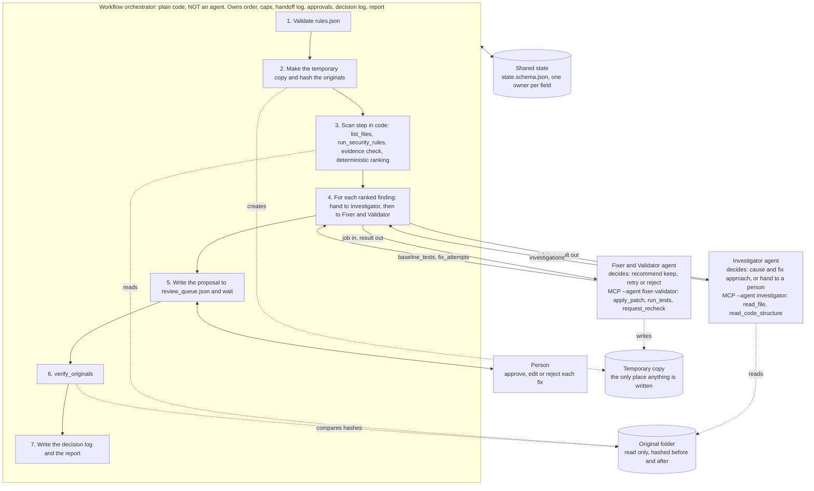

# Roster: single agent versus multi-agent, and what to do with the Auditor

Status: PROPOSAL, waiting for the team's OK. Nothing here has been built.
Sources: `AGENTS.md`; `canvas.md` sections 6, 9, 10, 12, 13; `schemas/state.schema.json` (the `x-owner` of each field); the tools in `tools/`; the result of `python evals/golden_table.py` (11 of 11 golden cases matched with no AI model).
If this file and `canvas.md` or `AGENTS.md` disagree, those two win until the team changes them.

---

## 1. The single-agent version

One model gets all seven tools (`list_files`, `read_file`, `run_security_rules`, `read_code_structure`, `apply_patch`, `run_tests`, `request_recheck`) and one long conversation, and is told to scan the project, find the weak spots, fix them, test the fixes and write the report. There is no orchestrator: the model itself decides when to make the temporary copy, when to stop, how many retries it has had, what to write in the log, and when a fix counts as verified. It is the simplest thing to build, and it fails the canvas in these places:

- **Section 13, "instructions hidden in code comments" (and case_09).** The same context that reads untrusted files with `read_file` also holds the write-capable tools `apply_patch` and `run_tests`. A comment that steers the model can steer a write or a test run directly. Nothing separates "reading hostile text" from "able to act".
- **Section 13, "a false fix", and section 6 "independent verification".** The model that writes the patch also decides whether it worked. The rule "verified only if the tests pass and the re-check is clear" becomes the model's own opinion of its own work.
- **Section 13, spec line (zero writes outside the copy, original files unchanged).** The tools refuse writes outside a registered copy, but only code can create that copy, hash the originals before the run and compare them after it. With no orchestrator, the model can skip either step. The stop rule ("stop at once and alert") has nobody to enforce it.
- **Section 12, human triggers.** "Resource limit reached" cannot be enforced by the thing being limited: a model does not reliably count its own steps, AI calls, tokens or minutes. "Wait for the person to approve, edit or reject" needs a component that can really stop and wait.
- **Section 12, handoff package and audit.** The decision log would be written by the party being logged, so a skipped or misreported decision leaves no independent trace. Audit completeness is a 100% gate.
- **Practical.** One context carries up to `file_cap` (200) files, every finding and every retry. It gets long, expensive (the 400,000 input-token cap) and hard to replay.

---

## 2. The multi-agent version: roster

Three agents and one plain-code orchestrator. Every handoff goes through the orchestrator; agents never call each other. This is the canvas design. Section 4 asks whether the Auditor row should stay.

| Agent | What it knows that no other agent knows | Tools: read | Tools: write | State fields it reads | State fields it writes | If it fails, what catches it |
| --- | --- | --- | --- | --- | --- | --- |
| **Auditor** | The whole-project picture: the full file list, every rule match, what was dropped and why, and the ranking. No other agent sees more than one finding. | `list_files`, `read_file`, `run_security_rules` | none | `input` (source folder, `file_cap`), `rules` | `file_list`, `skipped_files`, `skipped_rules`, `candidate_findings`, `dropped_findings`, `recheck_results` | Output must pass `state.schema.json` before handoff. `validate.py` checks that each `quoted_code` really appears at that file and line, so an invented finding is caught and dropped. Nothing found means the run ends as `safe_nothing_to_report`. A cap hit becomes `not_processed`. |
| **Investigator** | How data flows around one weak spot: callers and callees across files (`read_code_structure`) and the path from the source to the sink. It does not see the other findings or the tests. | `read_file`, `read_code_structure` | none | `input` (source folder), `file_list`, one entry of `candidate_findings` | `investigations` | The schema requires `handoff_reason` whenever `fixable` is false. The orchestrator then never starts the Fixer for that finding: status `needs_a_person`. A tool failure ("hands the case to a person") ends the same way. |
| **Fixer & Validator** | What happened when the patch ran: whether it applied, whether the code still parses, the test output tail, and why the first attempt failed. Nobody else sees run results. | `request_recheck` | `apply_patch` (temporary copy only), `run_tests` (runs code in the copy, changes nothing else) | `workspace`, `input` (`test_command`, `max_retries`), one `candidate_findings` entry, its `investigations` entry, its own earlier `fix_attempts` | `baseline_tests`, `fix_attempts` | `apply_patch` undoes a patch that does not apply or breaks the syntax. The orchestrator, not the agent, sets the status: `verified_awaiting_approval` only when tests pass and the re-check is clear. `decision` is only a recommendation. A person approves every fix. `verify_originals` runs at the end. |
| *Workflow orchestrator (not an agent)* | Everything about the run: counters, caps, the handoff log, the approvals. | none (calls helpers and the agents) | the temporary copy (`make_temp_copy`), `review_queue.json`, the log and the report | all fields | `run_id`, `input`, `rules`, `rules_file_version`, `workspace`, `counters`, `handoff_log`, `cap_hit`, `finding_status`, `approvals`, `audit_log`, `originals_unchanged`, `outcome`, `totals` | It is plain code with unit tests; it has no model to fail. A stop or an alert follows the stop rule. |

Two things in this table do not match the canvas wording. They are listed as open questions in section 6.

---

## 3. The three-sentence test, re-argued

Each answer below is argued from the actual tools and the golden cases, not copied from the canvas.

### Auditor
1. **Decides:** which of the scanner's hits are real reportable findings, and in what order a person should look at them.
2. **Chooses between:** keep, drop, or a rank position for each hit, using the quoted line and the code around it.
3. **What breaks as a plain tool call:** almost nothing for our three pilot rules. The pilot patterns are not raw text matches any more: `run_security_rules` already uses the parse tree for SQLI (so a SQL-looking log message is not reported, case_04) and, since the last fix, ignores `os.path.join` of fixed strings (case_03 test file). With those two fixes, the tool alone matched all 11 golden cases. A judgement step is left only for things the patterns cannot separate, and none of the 11 cases needed one.
- **Verdict: fails for the pilot rules.** It would pass only if AI-based detection or context ranking were in scope, and `AGENTS.md` section 2 says they are not.

### Investigator
1. **Decides:** whether the cause of one finding can be traced, and if so what shape of fix suits it; otherwise that a person must take over.
2. **Chooses between:** "fixable with approach X" and "hand to a person", using the call structure and the files it reads. The evidence that this is real judgement is in the golden set: SQLI is the same rule and the same detection in case_01 (simple), case_05 (spread over three files), case_07 (needs a redesign) and case_11 (no caller, so unknown). One detector, four different correct outcomes.
3. **What breaks as a plain tool call:** `read_code_structure` already returns callers and callees, but the answer to "does untrusted input reach this, and is the fix small?" is not computable from that list. A tool would have to either always say "fixable" (case_07 and case_11 get a wrong fix) or always escalate (the agent has no value).
- **Verdict: passes.**

### Fixer & Validator
1. **Decides (as the canvas words it):** keep, retry once, or reject a fix.
2. **Chooses between:** those three outcomes, using the test result, the syntax check and the re-check result.
3. **What breaks as a plain tool call:** the decision alone does not break. "Tests pass and re-check clear → keep; otherwise retry once; second failure → reject" is a lookup, and the schema already makes the orchestrator set the final status. What a tool cannot do is *write the diff* and *rewrite it after reading why the first attempt failed* (the `output_tail` of the tests, a `patch_does_not_apply` message).
- **Verdict: passes, but for a different reason than the canvas gives.** The agent earns its place through authoring and revising the patch, not through the keep/retry/reject decision. Recommendation: let the orchestrator derive keep/retry/reject from the results, as it already derives the status, and keep the `decision` field as the agent's advisory view.

---

## 4. The Auditor: recommendation

**Recommendation: option (b).** Replace the Auditor agent with `run_security_rules` plus a deterministic ranking, run as a plain-code scan step by the orchestrator.

Reasons:
- **The canvas says so itself.** Section 10: it stays an agent "only while AI-based rules and ranking are in scope. If the pilot used text-pattern rules only, collapse it into that tool plus a sort". Our pilot rules are SQLI, CMDI and PATH, and `AGENTS.md` section 2 puts AI-based detection out of the pilot.
- **Option (a) has nothing to justify it.** The only candidates are (1) AI-based detection rules, which are out of scope, and (2) AI ranking by context, for example "reachable from a request handler, so first". That second job is exactly the Investigator's job (case_11), so an Auditor doing it duplicates the Investigator and ranks before the evidence exists.
- **A model in the Auditor can only lose findings.** Every true finding is already found by the tool. A model that "judges" can only drop a real one, silently. High-severity recall has a gate of at least 90%, and the evidence rule already removes the unproven ones without a model.
- **Cost and risk go down.** One fewer handoff in the step cap, no model call and no code sent to a model for the whole-project scan (up to 200 files), and no context that holds hostile file contents plus a model's ranking power.
- **The recheck gets simpler.** `request_recheck` already calls `run_security_rules` directly. With the Auditor gone, "ask the Auditor" and the tool are the same thing (see open question 2).

What (b) needs, if the team agrees:
- **Deterministic ranking.** Sort by severity from `rules.json` (high, medium, low), then by the rule's position in `rules.json`, then by file and line. Same input, same order, every run.
- **Evidence step in code.** Keep a finding only if its `quoted_code` really appears at that file and line (the same check `validate.py` already does); otherwise put it in `dropped_findings` and log it.
- **Schema change.** The Auditor-owned fields (`file_list`, `skipped_files`, `skipped_rules`, `candidate_findings`, `dropped_findings`, `recheck_results`) get `x-owner: orchestrator`, and `auditor` leaves the actor and agent lists.
- **Confidence for rule matches.** The schema wants a number on every finding. The 0.70 gate applies to AI-alone findings only, so it does not apply. A constant must be agreed (open question 4).
- **`AGENTS.md` update.** Section 3 says the Auditor is "kept for now; test removing it after the evals". Choosing (b) now changes that team decision, so it needs your OK.

### Roster (a): keep the Auditor as an agent

| Name | Kind | Tools | Writes |
| --- | --- | --- | --- |
| Auditor | agent | `list_files`, `read_file`, `run_security_rules` | `file_list`, `skipped_files`, `skipped_rules`, `candidate_findings`, `dropped_findings`, `recheck_results` |
| Investigator | agent | `read_file`, `read_code_structure` | `investigations` |
| Fixer & Validator | agent | `request_recheck`, `apply_patch`, `run_tests` | `baseline_tests`, `fix_attempts` |
| Orchestrator | plain code | none | everything else |

Justification it would need: AI-based rules or AI ranking, neither of which is in the pilot. Handoffs per run: 1 audit, plus per finding 1 investigate and 1 or 2 fix attempts.

### Roster (b): scan step in code (recommended)

| Name | Kind | Tools | Writes |
| --- | --- | --- | --- |
| Scan step (list, rules, evidence check, rank) | plain code in the orchestrator | calls `list_files` and `run_security_rules` as functions | `file_list`, `skipped_files`, `skipped_rules`, `candidate_findings`, `dropped_findings`, `recheck_results` (all `x-owner: orchestrator`) |
| Investigator | agent | `read_file`, `read_code_structure` | `investigations` |
| Fixer & Validator | agent | `request_recheck`, `apply_patch`, `run_tests` | `baseline_tests`, `fix_attempts` |
| Orchestrator | plain code | none | everything else |

Three agents and three MCP profiles become two agents and two profiles (`--agent investigator`, `--agent fixer-validator`). The `auditor` profile in `tools/mcp_server.py` would be removed, or kept only for a later AI-based rules phase.

Handoffs per run: per finding 1 investigate and 1 or 2 fix attempts; the audit is no longer a handoff.

---

## 5. The chosen design (option b)

Agents never call each other: the arrows go only between an agent and the orchestrator. Every agent output is validated against `schemas/` before the orchestrator accepts it. The only way an agent reaches code is through its own MCP profile.

---

## 6. Open questions for the team

1. **The Fixer cannot read the file it patches.** `AGENTS.md` section 4 gives the Fixer & Validator `apply_patch`, `run_tests` and `request_recheck`, and no `read_file`. To write a unified diff it needs the lines it changes. Options: the orchestrator passes the relevant masked lines as a data field with the job, or `read_file` is added to the Fixer's tools (a change to the permissions table). Not decided here.
2. **`request_recheck` does not use an Auditor.** The canvas says the Fixer "asks the Auditor to run the rules again". In the code, the tool calls `run_security_rules` itself, and `state.schema.json` still lists `recheck_results` as Auditor-owned. Option (b) makes the code and the wording agree. Under option (a) the schema, the tool and the handoff job list would need an explicit Auditor re-check job.
3. **`AGENTS.md` says the Auditor is "kept for now; test removing it after the evals".** Option (b) removes it before the evals, with the evidence in section 4 (11 of 11 golden cases matched with the tool alone). If the team prefers to keep the decision as written, choose (a) and test removal later.
4. **Confidence for rule-matched findings without a model.** One documented constant, or a value by rule. The 0.70 gate does not apply. A value of 1.0 would claim more than we know.

Waiting for your OK on: option (a) or (b), and how to settle questions 1 to 4.
